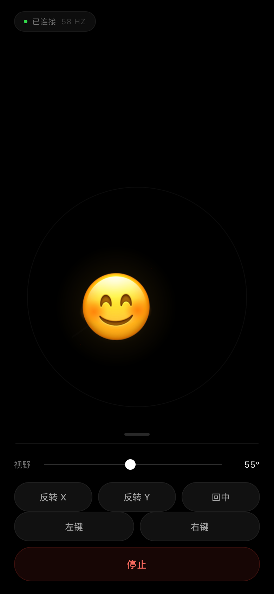

# iPhoneHandMouse

Tilt an iPhone, the Mac cursor follows. No hardware, no app install — one web page.



## Why this exists

There are already good AirPods-as-a-mouse projects: [AirPointer](https://github.com/musubipapi/airpointer) (the closed case), [AirCursor](https://github.com/m-afham/AirCursor) (head tracking on macOS), [MousePods](https://github.com/starman-tech/mousepods) (head tracking on Linux, plus the only public write-up of Apple's RemoteHID).

I had a knock-off pair of AirPods Pro 2. It advertises itself as `0x004C/0x2014`, so AirPointer picks it up and writes it into `closed-case-target.txt` — then the AACP channel opens and nothing answers. No motion service, no case IMU. Those projects need real Apple silicon in the bud.

The iPhone's IMU is fine and it's already in my hand. So this.

## How it works

```
iPhone Safari  ──wss:8443──▶  server.py  ──tcp:9000──▶  pointerd  ──CGEvent──▶  cursor
   (tilt)                    TLS + WS +                    Swift
                              pose math
                                  │
                                  └──broadcast:8444──▶ viewer (mirror window)
```

The phone does the rotation math (a ZXY matrix, not raw euler angles) and sends two tilt angles in degrees. The server maps those to absolute screen coordinates and forwards them to a small Swift process that posts `CGEvent`s.

Absolute mapping, not velocity: the cursor position is a function of the current angle, so holding still keeps the cursor still. An earlier version integrated the angle difference every frame and the pointer shot into a corner at 7800px/s.

## Run it

Mac:

```sh
./gen-certs.sh        # signs a cert for this Mac's LAN IP
./build.sh            # compiles pointerd and viewer
python3 launch.py     # starts everything, detached
```

iPhone:

1. Safari → `http://<mac-ip>:8080/ca.mobileconfig`, install the profile
2. Settings → General → About → Certificate Trust Settings → enable full trust for `HandMouse Local CA`
3. Safari → `https://<mac-ip>:8443/`
4. Tap 开始, allow motion access

Then tilt. The smiley follows your phone; the trail drags behind it.

Mac needs Accessibility permission for whatever process `pointerd` runs under (Terminal, if you started it from there).

## Mirror window

```sh
./viewer
```

A 430×920 window showing the same thing, for screen recording. It connects to `ws://127.0.0.1:8444/ws` — plaintext, loopback only — instead of the TLS port, because WKWebView refuses self-signed `wss` and just renders a white page.

The server broadcasts every processed pose to all other connected clients, so the mirror stays in sync without a second pipeline.

## Why the certificate

iOS 13+ gates `DeviceOrientationEvent` behind a secure context. On an http page the event simply never fires — no error, no prompt, nothing. Public tunnels work but add 100ms+, which is unusable for a pointer. So: local CA, profile install, done once.

## Things that bit me

- **`NWListener` can't be a TLS server here.** Network.framework sends the certificate and then the handshake just hangs — `openssl s_client` gets the cert chain and then waits forever. Python's `ssl` module worked first try. The old Swift server is gone.
- **`NWConnection.receive` with `[weak self]` needs an owner.** `listener.newConnectionHandler = { Client($0) }` allocates the client, hands it to nothing, and ARC frees it before a single byte arrives. The symptom looks exactly like a network problem: connection goes `ready`, then silence.
- **`CGWarpMouseCursorPosition` is not free.** It drops the system into "mouse detached" mode and every warp triggers a re-sync. Native `CGEvent` injection with delta fields is noticeably smoother.
- **`paused` was server-global.** Pause, reload the phone page, and the new session inherits `paused = True` — every pose gets dropped while the UI says it's running. New ws connections now reset it.
- **Euler angles cross-talk.** Reading `beta`/`gamma` directly, tilting right by 12° also dropped the cursor 125px. The fix is on the phone: build the rotation matrix, transform the device normal into the recentred frame, and send the decoupled angles.
- **The trail was invisible for three attempts.** Trail length was sampled by distance with a 7px threshold, so slow movement produced almost no points; then a fixed 150px minimum made it look like an antenna poking out of the head. It's now `24 + min(126, speed × 46)` px, drawn as tapered segments along the actual path.

## Tuning

| Slider | What it does |
|---|---|
| 视野 (FOV) | Degrees of tilt to the screen edge. 42° default, 90° if you want fine control |
| 反转 X / 反转 Y | Per-axis inversion |
| 停止 | Freezes the cursor; resumes with a fresh centre |

Server-side knobs in `server.py` → `Motion.feed`: deadzone `0.9°`, and a three-tier smoothing factor (0.93 fast / 0.66 medium / 0.07 still).

## Limits

- Tested on macOS 27 + one iPhone. Nothing else.
- The cert pins the LAN IP. Different network, re-run `gen-certs.sh` and reinstall the profile.
- Holding still there's ~1px of jitter. Cheaper than a laggy cursor.
- No tilt-to-click. Buttons on the phone, or wire up `CGEvent` yourself.
- Battery: the page holds a websocket and a motion listener, so don't leave it open in a bag.

## License

MIT
